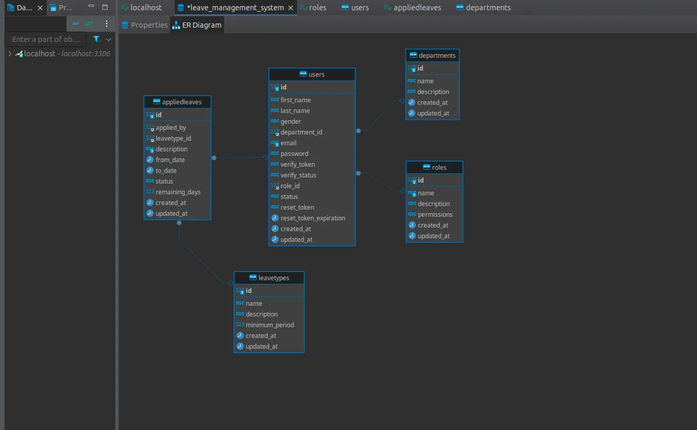
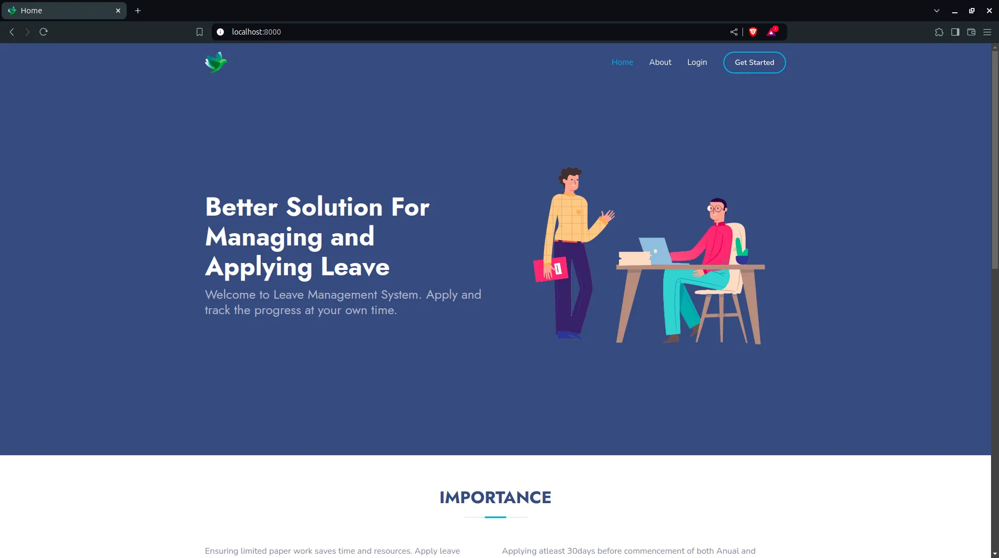
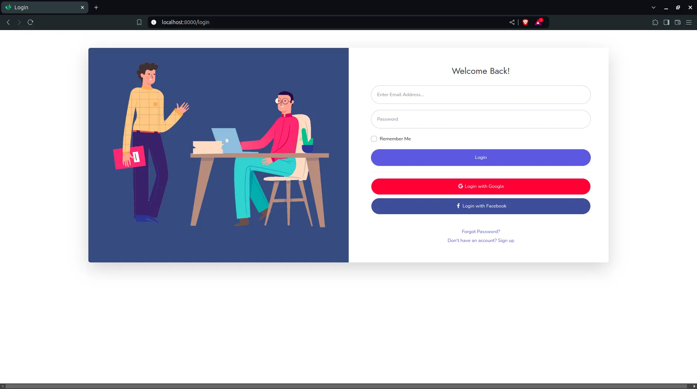
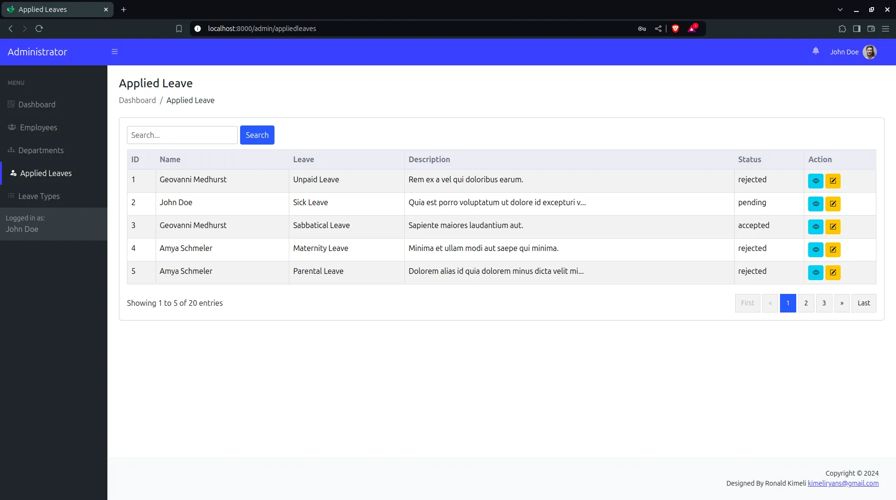
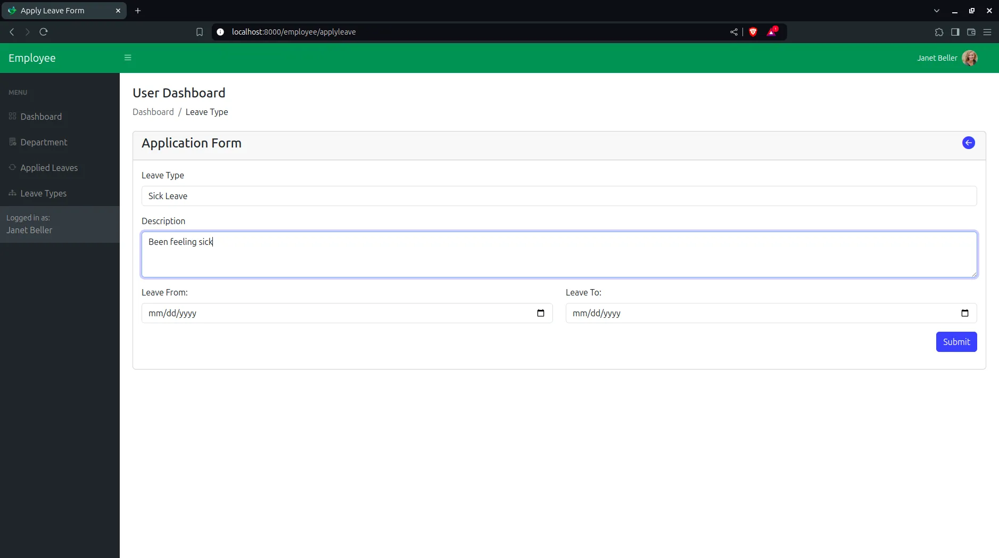
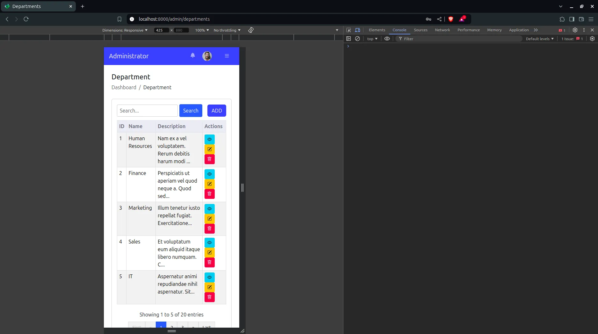

# Leave Management System

Leave requests without spreadsheets or email chains. Employees apply and follow their request; administrators review it and run the people, departments and leave types behind it.

Plain PHP 8.5 (OOP, MVC), MySQL/MariaDB through PDO, jQuery and Bootstrap. No framework to learn.

## Requirements

You need all of the following before installing.

| Requirement | Version | Why |
|---|---|---|
| **PHP** | **8.5 or newer** | Runtime for the app and the CLI scripts. |
| PHP extensions | `pdo_mysql`, `mbstring`, `openssl` | Database access, string handling, TLS for outgoing email. |
| **MySQL / MariaDB** | MySQL 8+ or MariaDB 10.6+ | Data store. The migration creates the database if your user may. |
| **Composer** | 2.x | Installs PHPMailer and Faker. |
| **Web server** | nginx + PHP-FPM, Apache (mod_rewrite), or PHP's built-in server for development | Must serve the `public/` folder. |
| SMTP account | any provider | Needed for registration emails and password reset. The rest of the app works without it. |
| Browser | any current Chrome, Firefox, Safari or Edge | The UI loads Bootstrap icons, Font Awesome and DOMPurify from public CDNs, so the browser needs internet access. |

Check your setup:

```bash
php -v                                    # must report 8.5 or newer
php -m | grep -Ei "pdo_mysql|mbstring|openssl"
composer --version
mysql --version                           # or: mariadb --version
```

Composer libraries (installed for you): `phpmailer/phpmailer` ^6.6 and `fakerphp/faker` ^1.23. Faker is only used to generate demo data.

## Installation

1. **Get the code and install dependencies**

   ```bash
   git clone https://github.com/ronald-kimeli/leave-management-php.git
   cd leave-management-php
   composer install
   ```

2. **Point it at your database.** Copy the sample and edit it. Use a database dedicated to this app: the migration drops and recreates its tables.

   ```bash
   cp src/database_sample.php src/database.php
   ```

   ```php
   'servername' => 'localhost',
   'database'   => 'leave_management',
   'username'   => 'your_db_user',
   'password'   => 'your_db_password',
   ```

3. **Set up email** (registration and password reset):

   ```bash
   cp src/smtp_sample.php src/smtp.php
   ```

   Fill in `host`, `from`, `username` and `password` for your SMTP provider.

4. **Create the tables, then add demo data.** Press Enter to accept each prompt (the default answer is yes).

   ```bash
   php bin/migrate.php          # all tables, or: php bin/migrate.php users
   php bin/seed.php             # 20 fake records per table plus the demo accounts
   ```

   > `bin/migrate.php` records what has run in a `migrations` table, so re-running only applies new entries. `php bin/migrate.php --fresh` drops every table in the database; never point it at a database that holds other data.

5. **Run it** from the project root.

   ```bash
   php -S localhost:8088
   ```

   Open <http://localhost:8088>. For a real server, see below.

## Features

**Public site**
- Landing page with an about section and the leave policy highlights.
- Registration with email verification, login, and password reset by email.

**Employees**
- Apply for leave: choose a leave type and dates, add a description.
- Follow each request as pending, accepted or rejected.
- Bell notification showing how many of their requests have been decided.
- See their department and every leave type with its description.
- Edit their profile.

**Administrators**
- Create, edit and delete employees, departments and leave types.
- Review each request and accept or reject it, with remaining days recorded.
- Bell notification showing how many requests are waiting for a decision.
- Dashboard with organisation-wide totals.

**Dark mode and auto-logout.** A toggle in the top bar switches between light and dark (remembered per browser), both driven by `public/assets/css/theme.css`. After 15 minutes of inactivity users get a warning and are then logged out (`SessionAuthMiddleware::IDLE_TIMEOUT`).

**One design, two roles.** Admins and employees share the same dashboard layout. The sidebar menu is built from the signed-in role, and each panel is closed to the other role: an employee who opens an admin URL is sent back to their own dashboard (and the other way round).

## Demo accounts

| Role | Email | Password |
|---|---|---|
| Admin | `admin@gmail.com` | `password123` |
| Employee | `employee@gmail.com` | `password123` |

Change or delete these before the app is reachable by anyone else.

## UI | UX

#### Database Design


#### Home Page


#### Login


#### Admin Applied Leaves


#### Employee Applied Leaves


#### Mobile Responsive


## Web server setup

**nginx + PHP-FPM**

```nginx
server {
    listen 80;
    server_name leave.test;
    root /path/to/leave-management-php/public;
    index index.php;

    location / { try_files $uri $uri/ /index.php?$query_string; }

    location = /index.php {
        include fastcgi_params;
        fastcgi_pass unix:/run/php-fpm/www.sock;   # your PHP 8.5 FPM socket
        fastcgi_param SCRIPT_FILENAME $document_root$fastcgi_script_name;
    }

    location ~ \.php$ { return 404; }   # only index.php may run
    location ~ /\.    { deny all; }     # hide dotfiles
}
```

**Apache**: set `DocumentRoot` to `public/` and enable `mod_rewrite`. The bundled `public/.htaccess` sends every non-file request to `index.php`, redirects HTTP to HTTPS, and sets the Nairobi time zone.

**Anything else**: keep `app/`, `src/`, `views/`, `vendor/`, `logs/` and `bin/` outside the web root or unreachable. Only `public/` should be exposed.

## How it works

- **Front controller.** Every request passes through `index.php` in the project root (`public/index.php` just loads it for virtual hosts), where routes are declared (`Route::get`, `post`, `put`, `delete`). Routes under the session group go through `SessionAuthMiddleware`.
- **MVC.** Controllers in `app/controllers` return a `View::render('admin.employees.index', ...)` result. Models in `app/models` extend a small query-builder `BaseModel` (in `app/support`) over PDO. A controller can also return `View::json([...])` or a plain array, and any page returns JSON for a request with `Accept: application/json`.
- **Layouts.** The public site uses `views/frontend`. Admin and employee pages are wrapped by the one layout in `views/layouts/dashboard`, which also does the role check and builds the menu from `menu.php`.
- **Database tooling.** `bin/migrate.php` builds tables from blueprints in `app/database`; `bin/seed.php` fills them.
- **Leave statuses.** `pending` until an admin sets it to `accepted` or `rejected`.

## Project layout

```
index.php            Front controller and route table
public/              Static files and the virtual-host entry: .htaccess, assets/, images/
app/
  controllers/       Controller base, FrontEnd, Session, admin/ and employee/ controllers
  models/            User, Role, Department, LeaveType, AppliedLeave
  support/           Route and BaseModel (router and query builder)
  database/          PDO wrapper, migrations, blueprints, seeder
  Middleware/        Session authentication
  Responses/         View rendering, JSON responses and redirects
views/               Page templates; layouts/ (dashboard shell) and components/ (public site parts)
bin/                 migrate.php, seed.php (command line only)
src/                 Your local config: database.php, smtp.php
logs/                Runtime logs and the database-error page
```

## Know how

**Add a column to an existing table.** Append an entry with a newer timestamp id to the `$migrations` array in `bin/migrate.php`, then run `php bin/migrate.php`. Never edit an entry that has already run.

```php
[
    'id' => '2026_10_28_120000_add_phone_to_users',
    'type' => 'add_columns',
    'table' => 'users',
    'up' => function ($table) {
        $table->string('phone', 20)->nullable()->comments("User's phone number");
    },
],
```

Make new columns `->nullable()` or give them a `->default(...)`, since the table may already hold rows.

## Security notes

- `src/database.php` and `src/smtp.php` hold credentials. Keep them out of version control (they are listed in `.gitignore`).
- Serve over HTTPS. Sessions and passwords travel in the clear otherwise.
- Seeded accounts all use `password123`.

## Troubleshooting

| Symptom | Fix |
|---|---|
| "Database connection failure" page | Check `src/database.php`; confirm the user can connect and create the database. Details are in `logs/database_error.log`. |
| `Failed opening required .../vendor/autoload.php` | Run `composer install`. |
| Blank or 404 on every route | Run `php -S localhost:8088` from the project root; on nginx or Apache the document root must be `public/` with a fallback to `index.php`. |
| Page loads without styles | Assets are served from `/assets/`; make sure the server does not rewrite static files to PHP. |
| No verification or reset email | Fill in `src/smtp.php` and check that your host allows outbound SMTP. |
| Wrong dates or times | Set `date.timezone` in your PHP config (the Apache `.htaccess` uses `Africa/Nairobi`). |
